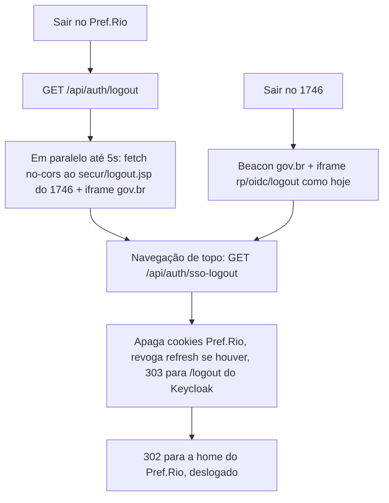

# Logout sincronizado Pref.Rio ↔ 1746

Documentação da feature que propaga o "Sair" entre o portal do cidadão (Pref.Rio / `superapp`) e o Experience Cloud do 1746 (Salesforce), ambos autenticados via Identidade Carioca (Keycloak) e, em cascata, gov.br.

**Escopo:** apenas logout **explícito** (clique em "Sair"). Timeout de sessão, logout pelo admin do Keycloak e sessão residual do gov.br ficam fora (ver §5).

**Status (código Pref.Rio):** implementado no `superapp`. Antes de produção, falta a validação em staging da §6 (bloqueante). A mudança correspondente no 1746 (§2.4) é feita pelo time do 1746 e só deve ir ao ar **depois** do Pref.Rio (ver §7).

---

## 1. Contexto e o desafio

### 1.1 Quatro sessões, um cidadão

Quando o usuário está logado nas duas aplicações, existem pelo menos quatro camadas de sessão:

| Camada | Onde mora | Papel |
|---|---|---|
| gov.br | cookies em `acesso.gov.br` | IdP externo; muitas vezes reloga o Keycloak sem senha |
| Keycloak | cookies no realm `idrio_cidadao` | SSO entre clients `superapp` e `1746-sf` |
| Pref.Rio | cookies HttpOnly `access_token` / `refresh_token` | JWT da aplicação Next.js |
| 1746 (Salesforce) | cookie `sid` do site Experience Cloud | sessão da comunidade |

Encerrar só a sessão do Pref.Rio **não** bastava: o usuário voltava ao 1746 ainda autenticado (e, muitas vezes, o Keycloak ainda mantinha a sessão SSO).

### 1.2 O IdP não consegue orquestrar o logout

- O discovery OIDC do Keycloak em uso **não anuncia** front-channel nem back-channel logout (`frontchannel_logout_supported` e `backchannel_logout_supported` ausentes).
- Como relying party, o Salesforce Experience Cloud participa de logout OIDC por front-channel (`/services/auth/rp/oidc/logout`), que depende de o IdP orquestrar, o que o Keycloak atual não faz de forma utilizável.

Conclusão: a propagação tem de ser feita **pelas próprias aplicações**, não pelo Keycloak.

### 1.3 Premissa errada: "domínios diferentes"

Uma análise inicial tratava Pref.Rio e 1746 como sites distintos (ex.: `*.sandbox.my.site.com`). Em staging/produção real:

- Staging: `staging.app.dados.rio` e `1746.staging.app.dados.rio`
- Produção: `pref.rio` e `1746.pref.rio`

A [Public Suffix List](https://publicsuffix.org/list/) só tem `rio`. O navegador trata Pref.Rio e 1746 como o **mesmo site** (*same-site*, mas *cross-origin*). Um `fetch` same-site leva os cookies do 1746 e **não** sofre o bloqueio de cookies de terceiros (ITP do Safari, Brave, Total Cookie Protection do Firefox).

Isso muda o desenho: do Pref.Rio para o 1746 dá para encerrar a sessão Salesforce com um `fetch` em segundo plano; do 1746 para o Pref.Rio, a CSP do Experience Cloud **bloqueia** `fetch` para o Pref.Rio, e aí a sinalização tem de ser **navegação de topo**.

### 1.4 Bug que motivou o ponto único de SSO logout

O endpoint antigo `GET /api/auth/logout` só chamava o logout POST do Keycloak **se ainda existisse** o cookie `refresh_token` (TTL ~30 min, renovado só em rotas `(logged-in)`).

Sem esse cookie, o Pref.Rio apagava os JWTs locais, mas a sessão SSO no Keycloak (`superapp` + `1746-sf`) **sobrevivia**. O cidadão "saía" do portal e ainda assim reabria o 1746 (ou o próprio Pref.Rio) sem senha via SSO.

---

## 2. Solução

### 2.1 Ideia

Cada "Sair" encerra a sessão da **outra** aplicação (quando possível) e os dois fluxos terminam no **mesmo** ponto: `GET /api/auth/sso-logout`.

Esse endpoint:

1. Revoga o refresh token se ainda houver.
2. Apaga os cookies do Pref.Rio (com os mesmos atributos do login, `AUTH_COOKIE_CONFIG`).
3. Responde `303` para o `/logout` do Keycloak com `post_logout_redirect_uri` = home do Pref.Rio.
4. **Ignora a query string** (nunca é open redirect da aplicação).
5. **Ignora pré-carregamentos** do navegador (`Sec-Purpose: prefetch`/`prerender`, `Purpose: prefetch`, `X-Moz: prefetch`): responde `503` sem efeito, para ninguém ser deslogado por prefetch ou pela barra de endereço. Tem de ser fora de 2xx: o Chrome reaproveita um prefetch 2xx (inclusive `204`) no clique real, e aí o logout não aconteceria; com `503` ele descarta o prefetch ([doc do Chrome](https://developer.chrome.com/docs/web-platform/prerender-pages)).
6. Registra um span OTel (`api.auth.sso_logout`) com o resultado de cada etapa.

Nenhum endpoint redireciona de volta para a outra app. Não há parâmetros de controle (`loggedOut`, `sync`) nem laço de redirects.

### 2.2 Fluxo



### 2.3 Pref.Rio → 1746

No cliente (`useLogout`):

1. `fetch('/api/auth/logout')`: contrato 204 inalterado. Apaga os cookies locais logo no início, para que fechar a aba durante a espera não deixe a sessão do Pref.Rio viva.
2. Em paralelo: `logoutFrom1746()` + `logoutFromGovbr()`.
3. `window.location.assign('/api/auth/sso-logout')`.

`logoutFrom1746` faz:

```ts
fetch(url, {
  mode: 'no-cors',
  credentials: 'include',
  cache: 'no-store',
  signal: timeoutSignal(5000), // AbortSignal.timeout com fallback p/ Safari < 16
})
```

A resposta é opaca; basta o Salesforce receber a requisição com o `sid`. Erros são ignorados (best-effort) e o fluxo segue para o SSO logout de qualquer forma.

### 2.4 1746 → Pref.Rio

A CSP do 1746 (meta tags) bloqueia `fetch` para o Pref.Rio. O "Sair" do 1746 deve, após o logout local Salesforce, navegar (topo) para:

```
${prefRio}/api/auth/sso-logout
```

tanto no `window.location.replace` quanto no `retUrl` do `secur/logout.jsp`.

- Só por navegação de topo. Por `fetch`, `sendBeacon` ou iframe, a CSP do 1746 bloqueia e o cookie do Keycloak não vai na requisição.
- O endpoint ignora query string; não há URL de retorno.
- O gate anônimo do 1746 (`a=1`, "Sair e abrir anônimo") **não** deve usar esse destino, senão o cidadão cai na home do Pref.Rio em vez do formulário.
- A URL é por ambiente: staging → `https://staging.app.dados.rio/api/auth/sso-logout`, produção → `https://pref.rio/api/auth/sso-logout`.

### 2.5 Por que navegação de topo no Keycloak

O POST de logout com `refresh_token` (ainda usado em `/api/auth/logout` e em `/api/auth/sso-logout` quando o cookie existe) **não** cobre o caso sem refresh. A navegação de topo para `/logout?post_logout_redirect_uri=…` encerra a sessão pelo **cookie** do Keycloak e devolve o usuário à home, inclusive depois que o refresh expirou.

O `client_id` vai na URL porque o Keycloak 18+ passa a exigi-lo quando não há `id_token_hint`. Isso **não basta** para o upgrade: ver §5.6.

---

## 3. O que mudou no código (Pref.Rio)

| Peça | Caminho | Função |
|---|---|---|
| Lib de logout servidor | `src/lib/auth-logout.ts` | `logoutFromKeycloak`, `clearAuthCookies`, `buildKeycloakLogoutUrl`, `isSpeculativeRequest` |
| Lib 1746 | `src/lib/1746-logout.ts` | `build1746LogoutUrl`, `get1746LogoutOrigin` |
| SSO logout | `src/app/api/auth/sso-logout/route.ts` | ponto final compartilhado (303 → Keycloak) |
| Logout local | `src/app/api/auth/logout/route.ts` | 204; só limpa cookies + tenta POST Keycloak |
| Hook do "Sair" | `src/hooks/use-logout.ts` | 1746 + gov.br em paralelo → `sso-logout` |
| CSP | `src/middleware.ts` | origem de `NEXT_PUBLIC_1746_LOGOUT_URL` em `connect-src` |

### Variável de ambiente

`NEXT_PUBLIC_1746_LOGOUT_URL` (build-time, como todo `NEXT_PUBLIC_*`):

| Ambiente | Valor |
|---|---|
| Staging | `https://1746.staging.app.dados.rio/solicitacaovforcesite/secur/logout.jsp` |
| Produção | `https://1746.pref.rio/solicitacaovforcesite/secur/logout.jsp` |

Wireada em `Dockerfile`, workflows de deploy/release/quality-gate, `.env.example` e READMEs. Sem ela, o logout do 1746 é pulado e o resto do fluxo segue normalmente.

Em staging, `connect-src` já tinha `https://*.app.dados.rio`. Em produção a origem `https://1746.pref.rio` precisa da variável para entrar na CSP.

### Telemetria

| Span | Atributos |
|---|---|
| `api.auth.logout` | `auth.logout.had_refresh_token`, `auth.logout.keycloak_revoke` |
| `api.auth.sso_logout` | os mesmos + `auth.logout.redirect_target` (`keycloak`/`home`), `auth.logout.speculative` |

`auth.logout.keycloak_revoke` ∈ `revoked`, `rejected`, `error`, `missing_credentials`. O logout do 1746 e do gov.br acontece no navegador e não aparece na telemetria do servidor.

---

## 4. Pontos fortes

- **Mesmo destino final** para os dois "Sair", sem laço de redirects entre apps.
- **Corrige o bug do refresh_token:** SSO Keycloak encerra mesmo após ~30 min sem renovação.
- **Same-site aproveitado de verdade:** matar o `sid` do 1746 a partir do Pref.Rio funciona sem depender de third-party cookies.
- **Resiliente a falha parcial:** se o 1746 ou o gov.br não responderem em 5 s, o fluxo ainda segue para o Keycloak e a home. Os cookies locais são apagados em qualquer caso.
- **`/api/auth/sso-logout` não é open redirect da aplicação:** query string ignorada; destinos vêm só de variáveis de ambiente.
- **Prefetch/prerender não deslogam.**
- Contrato de `GET /api/auth/logout` (204) preservado para quem já o consome.

---

## 5. Pontos fracos e limitações

### 5.1 gov.br

O logout do gov.br no Pref.Rio continua por **iframe** (e no 1746 por beacon). Em Safari, Brave e Firefox com bloqueio de cookies de terceiros, a sessão do gov.br **pode sobreviver**. Nessas condições, "Entrar" logo após "Sair" pode relogar sem senha via gov.br → Keycloak. É o principal risco residual em computadores compartilhados.

Correção estrutural: cadastrar a "URL de Log Out" na credencial do gov.br e fazer o logout dele por navegação de topo (idealmente pelo broker do Keycloak, já que o fluxo novo passa pelo `/logout` do Keycloak). **Fora deste escopo.**

### 5.2 Fim de sessão Keycloak sem "Sair"

Se a sessão do Keycloak expirar ou for morta pelo admin, o Pref.Rio **não percebe** de imediato: o `access_token` dura ~10 h e o middleware só olha o `exp`. Mitigações futuras: reduzir o tempo de vida do `access_token` e/ou back-channel logout (exige upgrade do Keycloak e estado no servidor).

### 5.3 Keycloak fora do ar

Depois do "Sair", cookies locais já foram apagados, mas o usuário pode parar na página de erro do Keycloak em vez da home.

### 5.4 Localhost

Em `localhost` o fluxo Pref.Rio → Keycloak → home funciona. O kill do `sid` do 1746 **não**: `localhost` e `*.dados.rio` não são o mesmo site, então o cookie Salesforce não vai no `fetch`. Validação completa Pref.Rio ↔ 1746 exige **staging**.

### 5.5 Logout por GET (risco aceito)

Qualquer site pode levar o navegador do usuário a `/api/auth/sso-logout` e deslogá-lo (*logout CSRF*). O mesmo já vale para o `/logout` do próprio Keycloak. O impacto é incômodo (o usuário precisa entrar de novo), sem vazamento de dados.

Não bloqueamos por `Sec-Fetch-Site` de propósito: o retorno do 1746 pode passar por domínios do Salesforce ou do Keycloak (que contam como *cross-site*), e Safari antigo não envia o header. Bloquear quebraria o fluxo legítimo.

### 5.6 Upgrade do Keycloak (18+) exige `id_token_hint`

Hoje o Pref.Rio não guarda o `id_token`. No Keycloak 18+, o `/logout` sem `id_token_hint`:

- mostra uma tela de confirmação ("Deseja sair?") antes de encerrar a sessão;
- só aceita `post_logout_redirect_uri` cadastrada em "Valid post logout redirect URIs" do client.

Antes do upgrade: passar a enviar `id_token_hint` (e cadastrar as URIs). Atenção ao guardar o `id_token` em cookie: soma ~1–3 KB ao header `Cookie`, que já leva `access_token` e `refresh_token`. Isso pode estourar limites de proxy (ex.: 8 KB por linha de header no nginx, que responde `400 Request Header Or Cookie Too Large`). Medir o tamanho real antes, ou guardar no servidor.

### 5.7 Sessão expirada não derruba o 1746 (decisão)

A página `/sessao-expirada` continua encerrando só o Pref.Rio e o gov.br. Derrubar o 1746 porque o token do Pref.Rio expirou poderia descartar um formulário de protocolo em preenchimento em outra aba. O escopo desta feature é o "Sair" explícito.

### 5.8 Achados de segurança de infraestrutura

Os achados sobre a infraestrutura de identidade e sobre o site do 1746 levantados nesta investigação foram reportados aos times responsáveis por canal interno. **Não documentar detalhes aqui:** este repositório é público.

---

## 6. Validação antes de produção (bloqueante)

Conferir **cada sistema**, não só a tela (o gov.br pode relogar sozinho):

- Keycloak: `/auth/realms/idrio_cidadao/account/sessions`
- 1746: `chatter/users/me` (403 = sessão encerrada)

| # | Cenário | Esperado |
|---|---|---|
| V1 | Logado nas duas, **Sair no Pref.Rio** | Home deslogada; 1746 → 403; sessão Keycloak encerrada. Confirma que o `fetch no-cors` ao `secur/logout.jsp` derruba uma sessão **ativa** do Salesforce. |
| V2 | Login feito **via gov.br**, Sair no Pref.Rio | Usuário termina na home do Pref.Rio. **Não** pode ficar preso numa página do gov.br ou do Keycloak (acontece se o IdP gov.br no Keycloak tiver logout configurado sem a URL de retorno cadastrada no gov.br). |
| V3 | Depois de V1, **botão Voltar** do navegador | Não pode exibir dados da página logada (CPF, carteira, perfil) a partir do cache. Recarregar deve pedir login. |
| V4 | Pref.Rio parado >30 min (refresh expirado), Sair | Sessão Keycloak também encerrada. |
| V5 | Só Pref.Rio logado, Sair | Sem erro e sem laço. |
| V6 | `GET /api/auth/sso-logout?redirect=https://evil.example` | Termina na home / Keycloak, nunca no domínio externo. |
| V7 | (após mudança SF) Logado nas duas, **Sair no 1746** | Chega em `/api/auth/sso-logout` → Keycloak → home Pref.Rio deslogada; sessão Keycloak encerrada. |
| V8 | (após mudança SF) Gate anônimo do 1746 (`a=1`) | Comportamento atual preservado; **não** vai para o Pref.Rio. |
| V9 | Telemetria | Spans `api.auth.logout` / `api.auth.sso_logout` no SigNoz com `auth.logout.keycloak_revoke=revoked`. |

Navegadores: Chrome (desktop e Android), Safari (macOS e iOS), Firefox, Samsung Internet.

Em produção: repetir V1, V2, V3 e V7 em `pref.rio` / `1746.pref.rio` a partir de uma **rota protegida** (onde a CSP vale), sem violação de CSP no console.

Se V3 falhar: adicionar no layout das rotas logadas um listener de `pageshow` que recarrega a página quando `event.persisted` é `true`.

---

## 7. Ordem de deploy e rollback

1. Validação em staging (§6, V1–V6).
2. Deploy do `superapp` em produção.
3. **Só então** o time do 1746 troca o destino final do "Sair" (§2.4). Se o 1746 apontar para `/api/auth/sso-logout` antes de o endpoint existir em produção, o "Sair" do 1746 cai num 404.
4. Validação conjunta (V7, V8) em staging e produção.

**Rollback:** o endpoint `/api/auth/sso-logout` não tem estado e **não deve ser removido** depois que o 1746 depender dele. Para desligar só o logout do 1746 a partir do Pref.Rio, rebuildar sem `NEXT_PUBLIC_1746_LOGOUT_URL` (variável de build). Para voltar ao comportamento antigo do "Sair" do Pref.Rio, reverter `src/hooks/use-logout.ts` e manter o endpoint.

### Fora do escopo, em paralelo

- Logout do gov.br por navegação de topo (§5.1).
- Upgrade do Keycloak + `id_token_hint` (§5.6) e back-channel logout (§5.2).
- Reduzir o tempo de vida do `access_token` (§5.2).
